# 离焦微结构镜片缺陷检测及评价系统使用手册

<!-- 按代理“软件操作使用手册-模版”：一、软件介绍；二、软件使用指南。截图位于 assets/，由 scripts/capture_gui_screenshots.py 生成。 -->

## 一、软件介绍

### 1、软件创作目的

离焦微结构镜片（近视防控镜片）表面分布着大量微透镜结构，佩戴和清洁过程中产生的划痕、斑点与缺损会降低镜片的离焦效果和视觉舒适度。目前镜片磨损程度主要依靠人工在显微镜下目视判断，结果受经验影响大、一致性差、难以留存。

离焦微结构镜片缺陷检测及评价系统（以下简称“本软件”）以暗场显微成像获得的整镜图像为输入，自动检测镜片缺陷，按镜片功能分区量化磨损程度，给出 0～100 的磨损评分（WearScore）和 A/B/C/D 四级评定结论，使非专业操作人员也能得到客观、一致、可追溯的检测结果。

### 2、软件主要功能

本软件提供以下功能：

| 功能 | 说明 |
|---|---|
| 图像导入 | 导入 PNG、BMP、TIFF 格式的整镜暗场显微图像，显示图像像素尺寸与物理尺寸 |
| 缺陷检测 | 对整镜图像切片推理，识别划痕、斑点、缺损三类缺陷，跨切片合并重复目标并链接断裂划痕 |
| 磨损评分与评级 | 按中心区、微结构区、边缘区加权计算磨损评分，给出 A/B/C/D 等级和文字结论 |
| 结果可视化 | 以检测叠加图、缺陷地形图、评分计算过程图和磨损评级卡片四个面板展示结果 |
| 批量检测 | 一次选择多张图像连续检测，汇总等级分布，导出 CSV 汇总表和 ZIP 报告包 |
| 检测记录 | 每次检测自动保存，可在检测记录页查询历史结果并下载检测报告 |
| 检测报告 | 生成包含评级、磨损指标、场景风险、贡献因素与结论的 HTML 报告及 JSON 数据 |
| 预处理工具 | 通过命令行完成背景标定、高光环配准、亮度校正与有效区域提取 |

### 3、软件技术特点

1. 针对暗场离焦成像特点，采用背景模板融合、高光环配准与亮度校正的预处理链路，减小成像条件差异对检测结果的影响。
2. 采用整镜切片推理：将约 3000×4096 像素的整镜图像按 640×640 像素、步长 480 像素切片检测，再将结果映射回整镜坐标。
3. 采用 IOS（交集占较小框比例）跨片合并算法去除切片重叠区域的重复检测，并按端点距离与方向夹角链接被切片截断的细长划痕。
4. 检测模型基于 YOLO 深度学习框架，引入浅层特征增强与 NWD（归一化 Wasserstein 距离）小目标度量，提升细小缺陷的检出能力。
5. WearScore 评分模型按镜片功能分区加权，并对各项物理量做对数饱和变换，评分结果可分解为五项贡献因素，便于解释。
6. 基于浏览器的图形化工作台，单张检测、批量检测、检测记录与报告下载在同一界面完成，无需编程基础。

### 4、运行环境

**硬件环境**

| 项目 | 要求 |
|---|---|
| 处理器 | x86-64 架构多核处理器 |
| 内存 | 16GB 及以上 |
| 硬盘 | 可用空间 20GB 及以上 |
| 显卡 | 推荐 NVIDIA 显卡，显存 4GB 及以上，支持 CUDA 12；无显卡时可使用 CPU 运行，检测速度较慢 |

**软件环境**

| 项目 | 要求 |
|---|---|
| 操作系统 | Linux（Debian 12/13、Ubuntu 22.04 及以上）或 Windows 10/11 |
| 运行环境 | Python 3.10 及以上 |
| 依赖软件 | PyTorch、Ultralytics、OpenCV、scikit-image、Gradio |
| 浏览器 | Chrome、Edge、Firefox 等现代浏览器 |

### 5、术语说明

| 术语 | 含义 |
|---|---|
| 暗场成像 | 只接收被缺陷散射的光线的显微成像方式，图像中缺陷呈亮色，完好区域呈暗色 |
| 划痕（scratch） | 细长的线状缺陷 |
| 斑点（spot） | 点状或块状的局部缺陷 |
| 缺损（critical） | 面积较大或结构复杂的严重缺陷区域 |
| 中心区 | 距光学中心小于镜片半径 40% 的区域，对视觉影响最大 |
| 微结构区 | 距光学中心为镜片半径 40%～75% 的区域，分布离焦微透镜结构 |
| 边缘区 | 距光学中心大于镜片半径 75% 的区域 |
| WearScore | 本软件定义的磨损综合评分，取值 0～100，分数越高磨损越严重 |
| 置信度阈值 | 检测模型输出缺陷的最低置信度，低于该值的候选目标被舍弃 |

<!-- pagebreak -->

## 二、软件使用指南

### 1、安装与启动

（1）安装依赖。在软件根目录打开终端，执行以下命令安装运行所需的 Python 依赖：

```
uv sync --extra viz
```

（2）启动软件。执行以下命令启动图形化工作台：

```
uv run python -m darkfield_defects.viz.app
```

终端显示服务地址后，在浏览器中打开 `http://127.0.0.1:7860` 即可进入软件主界面（图2.1）。

（3）指定模型权重（可选）。软件默认按以下顺序查找检测模型权重：环境变量 `DARKFIELD_WEIGHTS` 指定的文件、主线权重文件、基线权重文件。也可在界面“高级设置”中直接填写权重路径。

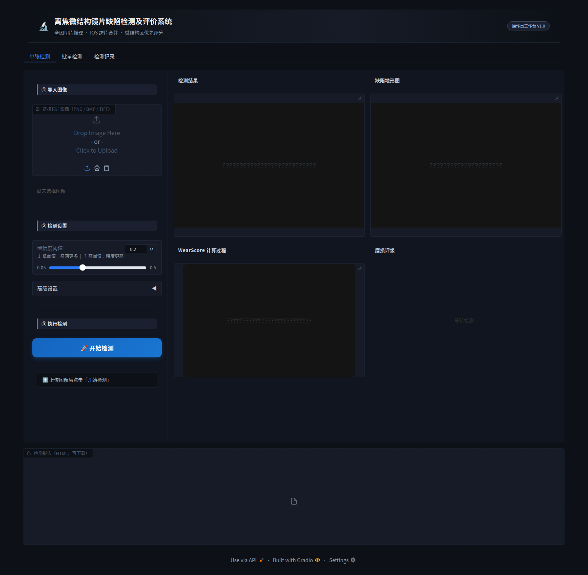

### 2、界面总览

软件主界面由顶栏和三个功能标签页组成：

- 顶栏：显示软件名称“离焦微结构镜片缺陷检测及评价系统”、处理流程说明和版本标识“操作员工作台 V1.0”。
- “单张检测”标签页：左侧为控制面板，按“① 导入图像 → ② 检测设置 → ③ 执行检测”三个步骤排列；右侧为 2×2 结果面板，依次显示检测结果、缺陷地形图、WearScore 计算过程和磨损评级。
- “批量检测”标签页：一次选择多张图像连续检测，并导出汇总结果。
- “检测记录”标签页：查询历史检测记录，查看结果并下载报告。

**系统运行示例（完整流程）**：图2.2 为一次完整检测的实际运行截图，依次为：① 导入镜片图像，界面显示文件名与物理尺寸；② 设置置信度阈值（可展开高级设置指定模型权重）；③ 点击“开始检测”，状态栏给出缺陷统计与评级，右侧四联面板显示检测叠加图、缺陷地形图、WearScore 计算过程和磨损评级卡片；④ 下载并打开检测报告。各步骤的详细说明见本章第 3 节。

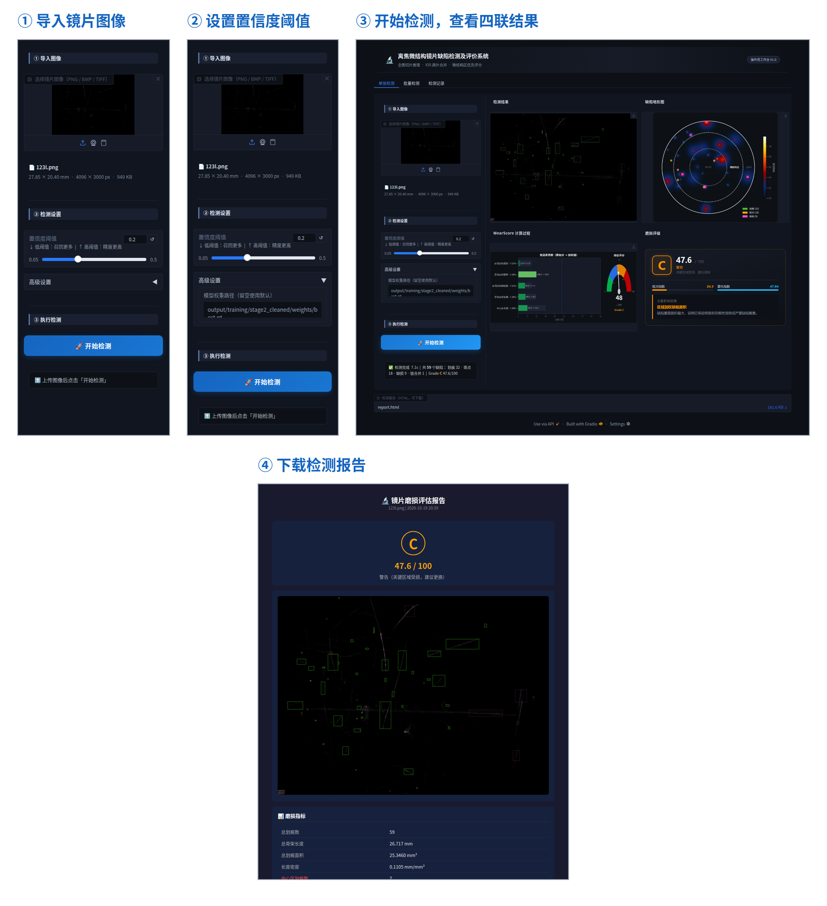

### 3、单张检测

#### （1）导入图像

在“① 导入图像”区域点击上传框，选择一张整镜暗场显微图像（支持 PNG、BMP、TIFF 格式），也可将图像文件直接拖入上传框。图像载入后，上传框显示图像缩略图，下方显示文件名、物理尺寸（按 6.8 μm/像素换算，单位 mm）、像素尺寸和文件大小（图2.3）。

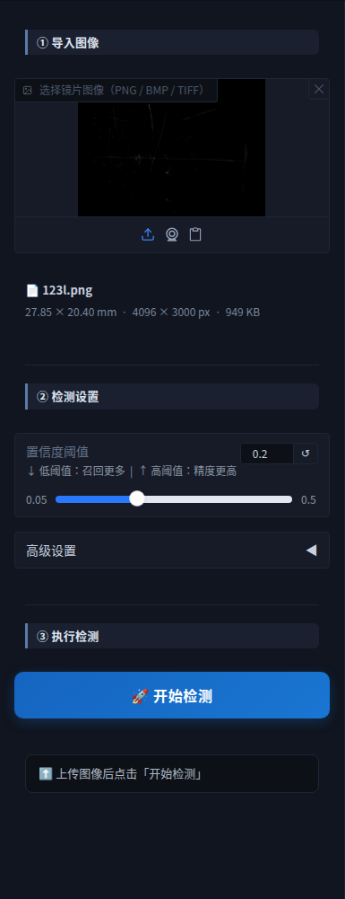

#### （2）检测设置

在“② 检测设置”区域拖动“置信度阈值”滑块设定检测阈值，可调范围 0.05～0.50，默认值 0.20。阈值越低，检出的缺陷越多（召回更高）；阈值越高，输出的缺陷越可靠（精度更高）。一般情况下保持默认值即可。

点击“高级设置”可展开权重路径输入框（图2.4）。留空时使用默认检测模型；需要使用其他模型时，填写模型权重文件的完整路径。

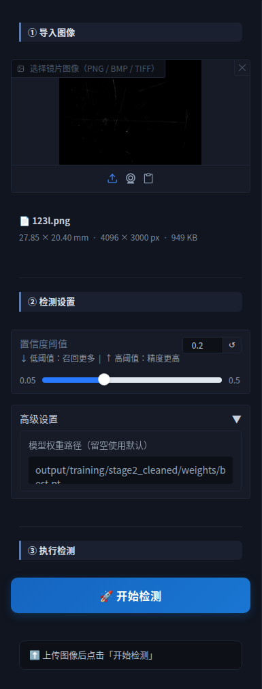

#### （3）执行检测

点击“③ 执行检测”区域的“开始检测”按钮，软件依次完成整镜切片、缺陷检测、跨片合并、划痕链接和磨损评分。检测完成后，按钮下方的状态栏显示检测耗时、缺陷总数、各类缺陷数量、划痕链接合并数以及评定等级和分数，右侧结果面板同步刷新（图2.5）。

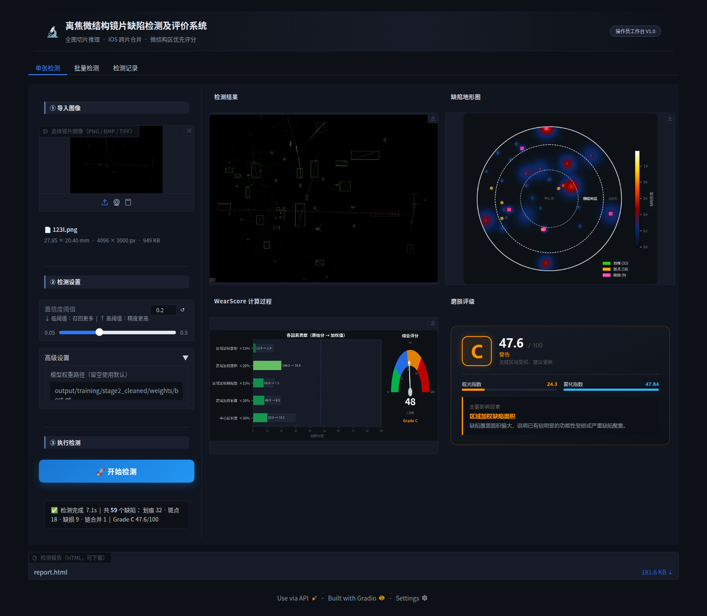

若检测失败（例如图像无法读取或模型权重不存在），状态栏以红色文字提示失败原因，请按提示检查图像文件或权重路径后重试。

#### （4）查看检测结果

**检测结果（缺陷标注叠加图）**：在镜片图像上用彩色矩形框标出检出的缺陷，绿色表示划痕，橙色表示斑点，紫色表示缺损；左下角图例显示各类缺陷数量（图2.6）。点击图像右上角的下载按钮可保存该图。

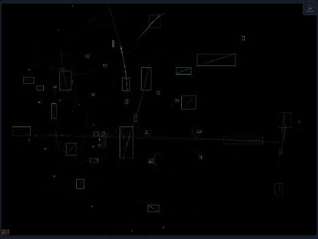

**缺陷地形图**：以热力图形式显示缺陷在镜片上的密度分布，并叠加中心区、微结构区、边缘区的分区圆环，便于判断缺陷是否集中在关键功能区（图2.7）。

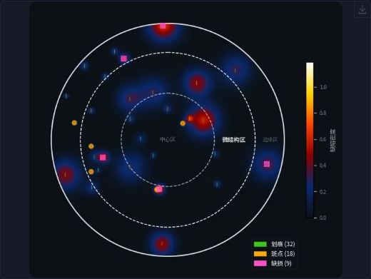

**WearScore 计算过程**：左侧条形图显示五项评分因素的原始分与加权值，右侧仪表盘显示综合评分（图2.8）。五项因素及权重见本章第 6 节。

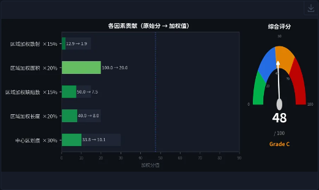

**磨损评级**：评级卡片显示磨损等级（A/B/C/D）、等级说明、综合评分、主要影响因素及文字结论（图2.9）。

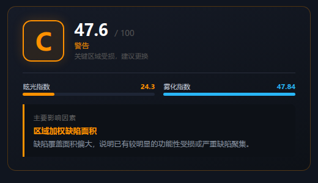

#### （5）下载检测报告

每次检测完成后，软件自动保存一条检测记录，并在结果面板下方的“检测报告（HTML，可下载）”处提供报告文件。点击文件名即可下载。报告可直接用浏览器打开（图2.10），内容包括：

- 评定等级与综合评分；
- 检测叠加图；
- 磨损指标：总划痕数、总长度、总面积、长度密度、中心区与微结构区和边缘区的长度、严重缺陷数、散射强度等；
- 场景风险：夜间眩光指数与雾化指数；
- 贡献因素条形图；
- 评估结论。

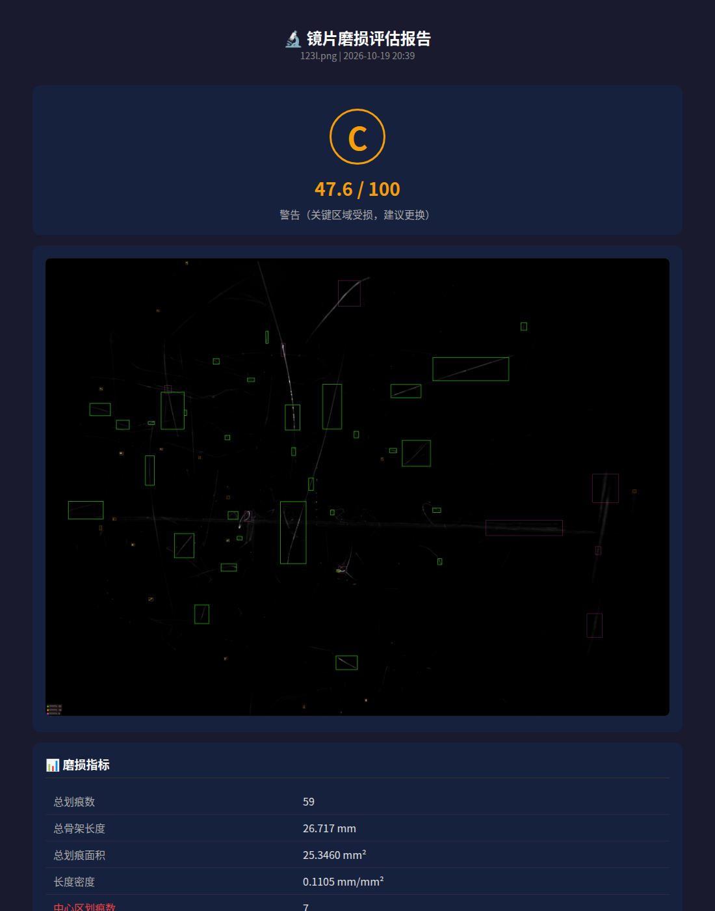

### 4、批量检测

批量检测用于一次处理多张镜片图像，操作步骤如下：

1. 点击顶部“批量检测”标签页。
2. 在“① 选择多张图像”区域点击上传框，按住 Ctrl 或 Shift 键选择多张图像，或一次拖入多个文件。
3. 在“② 检测设置”区域设定置信度阈值。批量检测使用“单张检测”页“高级设置”中填写的权重路径，留空时使用默认模型。
4. 点击“批量检测”按钮。检测过程中界面显示进度条。
5. 检测完成后，状态栏显示完成张数和 A/B/C/D 各等级数量；右侧“批量结果汇总”表格逐行列出每张图像的记录编号、文件名、检测时间、等级、评分、缺陷总数、各类缺陷数和推理耗时（图2.11）。
6. 点击“汇总表（CSV）”下载汇总表，可用 Excel 打开；点击“全部报告（ZIP）”下载包含汇总表及每张图像报告、叠加图的压缩包。

单张图像检测失败不会中断整批任务，失败的文件名及原因显示在状态栏中。

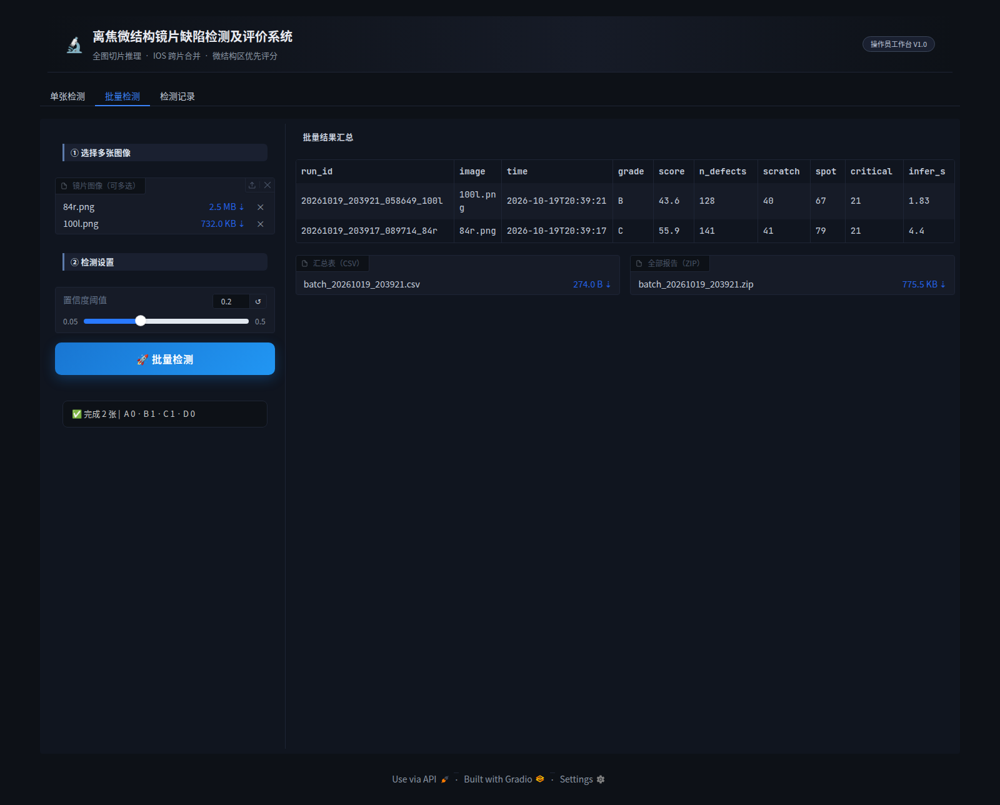

### 5、检测记录

“检测记录”标签页用于查询历史检测结果（图2.12）：

1. 打开该标签页时，软件自动加载最近的检测记录，按时间倒序列在表格中；点击“刷新记录”可重新加载。
2. 在“查看记录”下拉框中选择一条记录编号，下方显示该次检测的叠加图和磨损评级卡片。
3. 点击“检测报告（HTML）”处的文件名下载该次检测报告。

检测记录默认保存在软件目录下的 `output/app_runs/` 中，每条记录为一个以“日期_时间_图像名”命名的文件夹，内含 `report.json`、`report.html` 和 `overlay.png` 三个文件。可通过环境变量 `DARKFIELD_RUNS_DIR` 指定其他保存位置。

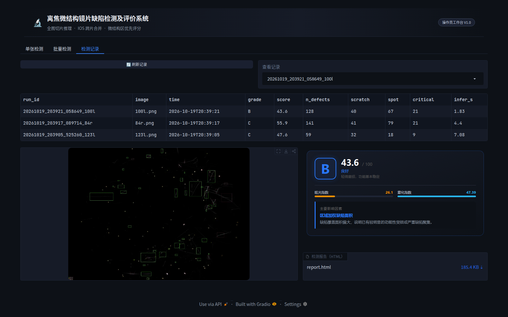

### 6、磨损评分与等级说明

软件首先统计各类缺陷在三个功能区内的长度、数量、面积和散射强度，再计算五项评分因素。每项因素经对数饱和变换映射到 0～100 分，按下表权重加权求和得到 WearScore（上限 100 分）。

| 评分因素 | 含义 | 权重 |
|---|---|---|
| 中心区划痕 | 中心区内缺陷长度 | 0.30 |
| 区域加权长度 | 中心区、微结构区、边缘区长度按 1.0、0.8、0.3 加权 | 0.20 |
| 区域加权面积 | 各区缺陷面积按区域系数加权，严重缺陷额外计入 | 0.20 |
| 区域加权缺陷数 | 各区缺陷数量按区域系数加权，严重缺陷额外计入 | 0.15 |
| 区域加权散射 | 各区缺陷散射亮度按区域系数加权 | 0.15 |

等级按 WearScore 划分如下：

| 等级 | WearScore 范围 | 含义 |
|---|---|---|
| A（极佳） | 0～20 | 中心区与微结构区基本完好 |
| B（良好） | 20～45 | 轻微磨损，功能基本稳定 |
| C（警告） | 45～70 | 关键区域受损，建议更换 |
| D（报废） | 70 以上 | 关键功能区严重受损 |

评级卡片中的“主要影响因素”为加权值最大的评分因素，可据此判断镜片磨损的主要来源。

### 7、命令行预处理工具

对于成像条件与模型训练数据不一致的原始暗场图像，可先使用命令行工具完成预处理，再导入图形界面检测。

（1）背景标定：从一组背景图像生成高光环掩膜、有效区域（ROI）和亮度修正参考参数。

```
uv run darkfield-defects roi-calibrate <背景图目录> --save output/calibration
```

（2）批量预处理：对目标图像进行高光环匹配、ROI 投影和背景修正，并输出质量报告 `quality_report.json`。

```
uv run darkfield-defects roi-process <图像目录> --calibration output/calibration --output output/processed
```

（3）单张预处理：

```
uv run darkfield-defects preprocess <图像路径> --calibration output/calibration
```

（4）查看命令帮助：

```
uv run darkfield-defects --help
```

### 8、常见问题

| 问题 | 处理方法 |
|---|---|
| 状态栏提示“模型权重不存在” | 在“高级设置”中填写正确的权重文件路径，或设置环境变量 DARKFIELD_WEIGHTS |
| 浏览器无法打开 http://127.0.0.1:7860 | 确认终端中软件已启动且未报错；若端口被占用，关闭占用程序后重新启动 |
| 检测速度较慢 | 检查是否在使用显卡运行；无显卡时 CPU 推理每张图像需要较长时间 |
| 检出缺陷明显偏少或偏多 | 适当调整置信度阈值；确认图像为经过预处理的暗场整镜图像 |
| 检测记录页没有记录 | 点击“刷新记录”；确认检测已成功完成，且保存目录可写 |
